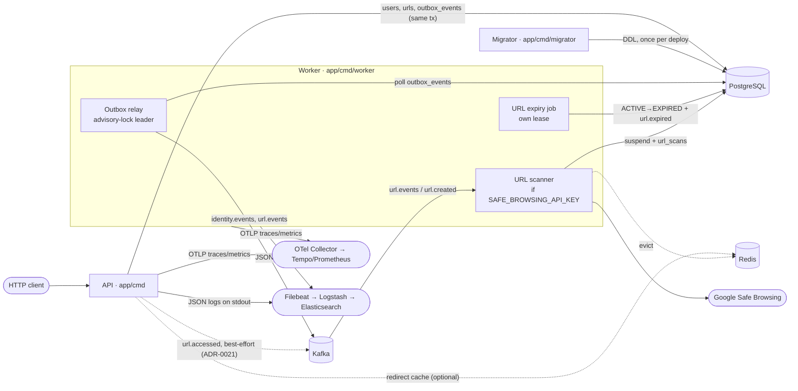

# Architecture

Fupi is a URL shortener built as one Go module (`github.com/sanctumlabs/fupi`) with a hexagonal core. The same core is wired into three processes, and all three ship in one distroless image ([ADR-0016](./adr/0016-runtime-image-is-distroless-and-defaults-to-production.md)). This document describes those processes, the layers inside them, the boundaries between them, and the tooling around the code.

## Processes

| Process | Entry point | Responsibility | Dependencies |
|---|---|---|---|
| **API** (`/app/fupi`) | [app/cmd/main.go](../app/cmd/main.go) | Fiber HTTP server: Identity (register, login, token refresh, verify), URL management, the public redirect `GET /:code`, probes and `/docs` | Postgres (required), Redis (optional), Kafka (optional, only for `url.accessed`) |
| **Worker** (`/app/worker`) | [app/cmd/worker/main.go](../app/cmd/worker/main.go) | Three jobs: the outbox relay, the URL expiry job and, when `SAFE_BROWSING_API_KEY` is set, the URL scanner | Postgres and Kafka (both required), Redis (only when scanning) |
| **Migrator** (`/app/migrator`) | [app/cmd/migrator/main.go](../app/cmd/migrator/main.go) | Applies the SQL migrations once per deploy and exits ([ADR-0010](./adr/0010-golang-migrate-for-schema-migrations.md), [ADR-0014](./adr/0014-migrations-run-from-a-migrator-command.md)) | Postgres |

The API never applies migrations and never publishes the outbox. It writes domain events to the `outbox_events` table in the same transaction as the state change, and the worker delivers them ([ADR-0011](./adr/0011-single-broker-agnostic-outbox.md), [ADR-0015](./adr/0015-postgres-is-the-only-required-dependency.md), [ADR-0018](./adr/0018-the-outbox-relay-is-one-leader-elected-polling-worker-over-franz-go.md)). The one exception is `url.accessed`, which the API publishes to Kafka directly and on a best-effort basis, because a redirect has no transaction to join ([ADR-0021](./adr/0021-the-api-publishes-url-accessed-best-effort-without-the-outbox.md)).

Kafka topics:

| Topic | Producer | Consumer |
|---|---|---|
| `identity.events` | outbox relay (rows written by [user_write_datastore_adapter.go](../app/internal/adapters/postgres/identity/user_write_datastore_adapter.go)) | none in this repo |
| `url.events` | outbox relay (rows written by [url_write_datastore_adapter.go](../app/internal/adapters/postgres/url/url_write_datastore_adapter.go)) | worker URL scanner, consumer group `fupi-url-scanner` |
| `url.accessed` | API access recorder ([access.go](../app/internal/application/url/access.go)) | none in this repo |

## Layers

The code follows [Hexagonal Architecture](https://en.wikipedia.org/wiki/Hexagonal_architecture_(software)). The domain and the use cases depend only on ports, so swapping the storage, the broker or the token issuer means writing a new adapter, with no change to the domain or the use cases.

- **domain** ([app/internal/domain](../app/internal/domain/)): the `identity` and `url` aggregates, their value objects and domain events. Each aggregate owns its status transitions ([ADR-0002](./adr/0002-url-aggregate-owns-status-transitions.md), [ADR-0008](./adr/0008-identity-verification-and-status.md)). This layer imports no infrastructure.
- **core** ([app/internal/core](../app/internal/core/)): the shared kernel, `entity` (UUIDv7 `ID`, `AggregateRoot`, `DomainEvent`; [ADR-0001](./adr/0001-uuidv7-app-generated-ids.md)) and the generic `ports/repository` interfaces.
- **ports**: interfaces the application needs from outside. They live in three places:
  - persistence ports belong to their aggregate: `url.UrlReadDatastore`/`UrlWriteDatastore` in [domain/url/datastore.go](../app/internal/domain/url/datastore.go) and `identity.UserReadDatastore`/`UserWriteDatastore` in [domain/identity/user_datastore.go](../app/internal/domain/identity/user_datastore.go) ([ADR-0013](./adr/0013-ports-are-named-datastore.md))
  - shared outbound ports are in [app/internal/ports](../app/internal/ports/): `RedirectCache`, `EventPublisher`, `OutboxDatastore`, `Leaser`, `Lease`, `URLScanner`, `UrlScanDatastore`, `GeoLocator`, `TokenService`, `Notifier`, `ShortCodeGenerator`
  - the generic bases `ReadRepositoryPort[T]` and `WriteRepositoryPort[T]` are in [core/ports/repository](../app/internal/core/ports/repository/repository.go)
- **application** ([app/internal/application](../app/internal/application/)): the use cases.
  - `identity`: register, login, refresh, verify, admin check
  - `url`: shorten, resolve, manage, moderate, the redirect cache, access recording
  - `outbox`: the relay
  - `security`: handling scan results
  - `urlexpiry`: the expiry job
- **adapters** ([app/internal/adapters](../app/internal/adapters/)): the port implementations.
  - `postgres/{identity,url,outbox,scan}` are the datastores. The root `postgres` package holds the outbox writer and the short-code generator ([ADR-0019](./adr/0019-short-codes-are-a-keyed-permutation-of-the-counter.md)).
  - `kafka`, `redis` (redirect cache), `jwtauth`, `notifications`, `safebrowsing` and `geolocation` implement the remaining ports.
- **api** ([app/api](../app/api/)): the HTTP layer, which turns requests into use-case calls and errors into responses. It holds `v1/identity`, `v1/url`, the JWT auth `middleware`, the `probes` and the embedded `openapi` spec ([ADR-0023](./adr/0023-openapi-spec-is-generated-from-the-handlers.md)).
- **pkg** ([app/pkg](../app/pkg/)): code that doesn't know about the domain. [pkg/infra](../app/pkg/infra/) holds the Fiber server and its middleware, the Postgres client and migrator, the Redis client, the franz-go Kafka producer and consumer, telemetry, health checks and logging. The rest of `pkg` is shared libraries: `errdefs`, `jwt`, `validators`, `identifier` and `utils`.
- **config** ([app/config](../app/config/)): typed environment loaders.
- **cmd** ([app/cmd](../app/cmd/)): the composition roots. All wiring happens here, and nothing else in the module imports `cmd`.

### Package dependencies

The graph below comes from `go list -f '{{.Imports}}' ./app/...`. Leaf utilities (`errdefs`, `internal/pkg/common`, `utils`) are left out to keep it readable. The dashed ⚠ edges are imports that point the wrong way across layers; see [Known gaps](#known-gaps).

```mermaid
flowchart TB
  subgraph cmd["app/cmd (composition roots)"]
    cAPI[cmd]
    cW[cmd/worker]
    cM[cmd/migrator]
  end
  CFG[app/config]
  subgraph api["app/api"]
    aID[v1/identity]; aURL[v1/url]; aMW[middleware]; aPR[probes]; aOA[openapi]
  end
  subgraph app["internal/application"]
    pID[identity]; pURL[url]; pOB[outbox]; pSEC[security]; pEXP[urlexpiry]
  end
  subgraph dom["internal/domain + core"]
    dID[domain/identity]; dURL[domain/url]; cENT[core/entity]; cREP[core/ports/repository]
  end
  PORTS[internal/ports]
  subgraph adp["internal/adapters"]
    xPG[postgres]; xPGI[postgres/identity]; xPGU[postgres/url]; xPGO[postgres/outbox]; xPGS[postgres/scan]; xSQL[postgres/sql · sqlc]
    xK[kafka]; xR[redis]; xJWT[jwtauth]; xN[notifications]; xSB[safebrowsing]; xGEO[geolocation]
  end
  subgraph infra["pkg/infra"]
    iSRV[server + middleware + router]; iDB[database/postgres]; iC[cache/redis]; iQ[queue/kafka]; iT[telemetry]; iH[monitoring/health]; iTR[tracing]
  end

  cAPI --> aID & aURL & aMW & aPR & CFG
  cAPI --> pID & pURL
  cAPI --> xPG & xPGI & xPGU & xK & xR & xJWT & xN & xGEO
  cAPI --> iSRV & iDB & iC & iQ & iT & iH
  cW --> aPR & CFG & pOB & pSEC & pURL & pEXP
  cW --> xK & xPGO & xPGS & xPGU & xR & xSB
  cW --> iDB & iC & iQ & iT & iH
  cM --> CFG & iDB

  aID --> pID & dID
  aURL --> pURL & dURL & aMW
  aMW --> PORTS
  aPR --> iH

  pID --> dID & PORTS
  pURL --> dURL & PORTS & cREP
  pSEC --> dURL & PORTS
  pEXP --> dURL & PORTS & iT
  pOB --> PORTS & iT

  dID --> cENT & cREP
  dURL --> cENT & cREP
  PORTS --> dURL

  xPGI --> xPG & xSQL & dID
  xPGU --> xPG & xSQL & dURL
  xPG --> xSQL & PORTS & iDB
  xPGO --> xSQL & PORTS & iDB
  xPGS --> xSQL & PORTS & iDB
  xK --> PORTS & iQ
  xR --> PORTS & dURL & iC
  xJWT --> PORTS
  xN --> PORTS
  xSB --> PORTS
  xGEO --> PORTS

  CFG --> iC & iDB
  iH --> iT
  iDB -. "⚠ pkg→internal" .-> xSQL
  iSRV -. "⚠ pkg→api" .-> aOA
  iTR -. "⚠ pkg→internal" .-> cENT
  xJWT -. "⚠ adapter→config" .-> CFG
```

## Runtime boundaries

### API layer

[server.NewServer](../app/pkg/infra/server/server.go) installs the middleware in this order: OpenTelemetry → request ID → access log → CORS → the `/docs` rewrite and Swagger (public) → Helmet → idempotency → recover. [main.go](../app/cmd/main.go) then adds the JWT auth middleware and registers the routers. The auth middleware's allowlist holds the auth endpoints, the probes, `/docs/` and the redirect pattern. The URL router is registered last because `GET /:code` matches any single-segment path.

| Route | Auth | Router |
|---|---|---|
| `POST /api/v1/fupi/auth/{register,login,oauth/token}`, `GET …/auth/verify` | public | [v1/identity/router.go](../app/api/v1/identity/router.go) |
| `POST`/`GET /api/v1/fupi/urls`, `GET`/`PATCH`/`DELETE …/urls/:id` | bearer token | [v1/url/router.go](../app/api/v1/url/router.go) |
| `POST /api/v1/fupi/urls/:id/reinstate` | bearer token + admin role, read from the datastore on every call ([ADR-0022](./adr/0022-urls-are-scanned-from-url-created-and-only-admins-reinstate.md)) | [v1/url/router.go](../app/api/v1/url/router.go) |
| `GET /:code` | public | [v1/url/router.go](../app/api/v1/url/router.go) |
| `GET /health`, `GET /health/ready` | public | [probes/router.go](../app/api/probes/router.go) |
| `GET /docs/` | public | [server.go](../app/pkg/infra/server/server.go) |

Liveness checks nothing. Readiness answers 503 when Postgres is down or the process is draining, and reports Redis as `degraded` without failing ([ADR-0015](./adr/0015-postgres-is-the-only-required-dependency.md)).

### Domain layer

The domain imports only `core/entity`, `core/ports/repository`, `errdefs`, `validators`, `identifier` and `internal/pkg/common`. Aggregates are the only place statuses change. Each transition records a domain event, which the datastore writes to the outbox. The value-object limits are in [ADR-0003](./adr/0003-value-object-limits.md), and the alias/short-code disjointness rule is in [ADR-0020](./adr/0020-custom-aliases-cannot-have-the-shape-of-a-short-code.md).

### Persistence

PostgreSQL is the system of record for users, URLs, keywords, URL scans and the transactional outbox.

- **Migrations:** paired `up`/`down` SQL files in [app/internal/adapters/postgres/migrations](../app/internal/adapters/postgres/migrations/), applied by the migrator.
- **Queries:** generated by [sqlc](https://sqlc.dev) from [schema.sql](../app/internal/adapters/postgres/sql/schema.sql) and the `.sql` files under [sql/queries](../app/internal/adapters/postgres/sql/queries/) ([sqlc.yaml](../sqlc.yaml)). `schema.sql` must match the applied migrations.
- **Statuses:** Postgres enums ([ADR-0012](./adr/0012-url-status-is-a-postgres-enum.md)).
- **Outbox:** a datastore write appends the aggregate's events to `outbox_events` in the same transaction, through [outbox.go](../app/internal/adapters/postgres/outbox.go). If the outbox insert fails, the whole write fails.

Redis holds a cache, never data. The redirect cache (the `ports.RedirectCache` port, implemented by [adapters/redis](../app/internal/adapters/redis/) on top of [pkg/infra/cache/redis](../app/pkg/infra/cache/redis/)) stores resolved targets with a TTL, and stores unknown codes with a shorter absent TTL. A miss falls through to Postgres, so losing Redis only slows redirects down.

### Async jobs

All three worker jobs run in [app/cmd/worker](../app/cmd/worker/). The API also runs one in-process async path.

- **Outbox relay** ([application/outbox](../app/internal/application/outbox/), datastore [adapters/postgres/outbox](../app/internal/adapters/postgres/outbox/))
  - Workers compete for a Postgres advisory lock, and only the holder relays.
  - The holder polls unsent rows per destination and publishes them through franz-go.
  - Delivery is at least once. Consumers de-duplicate on the `event_id` header.
  - Permanent broker rejections are parked. Sent rows are purged after `OUTBOX_RETENTION_DAYS`.
  - The relay carries `traceparent` from the request through to Kafka ([ADR-0018](./adr/0018-the-outbox-relay-is-one-leader-elected-polling-worker-over-franz-go.md)).
- **URL expiry job** ([application/urlexpiry](../app/internal/application/urlexpiry/))
  - It elects its own leader on a separate lease (`fupi.url.expiry`), so it can run on a different instance from the relay.
  - It moves `ACTIVE` URLs past their expiry to `EXPIRED`, and `url.expired` reaches the outbox.
- **URL scanner** ([application/security](../app/internal/application/security/), [adapters/safebrowsing](../app/internal/adapters/safebrowsing/), [adapters/postgres/scan](../app/internal/adapters/postgres/scan/); wired in [scanning.go](../app/cmd/worker/scanning.go))
  - It consumes `url.created` from `url.events` and asks Google Safe Browsing about each target.
  - A malware or phishing verdict suspends the URL and evicts it from the redirect cache.
  - A scanner outage is retried and is never treated as a verdict ([ADR-0022](./adr/0022-urls-are-scanned-from-url-created-and-only-admins-reinstate.md)).
- **Access recorder** (API process, [application/url/access.go](../app/internal/application/url/access.go))
  - Redirects queue the visit on a buffered channel; when the channel is full the visit is dropped and counted.
  - One goroutine resolves the country (currently `geolocation.Unknown`), classifies the device and publishes to `url.accessed`.
  - Delivery is at most once ([ADR-0021](./adr/0021-the-api-publishes-url-accessed-best-effort-without-the-outbox.md)).

### Configuration

All settings come from the environment through [app/config](../app/config/). A `.env` file is loaded first when present, and [.env.example](../.env.example) documents every variable with its default.

- `config.Load` builds `config.App` for the API, and `config.LoadWorker` builds `config.Worker`. Both report every invalid variable at once, not just the first.
- Outside `development` and `test`, the loaders refuse the development secrets (`AUTH_SECRET`, `SHORT_CODE_KEY`, database and Redis passwords).
- The container `healthcheck` subcommand uses narrow loaders (`LoadServer`, `LoadWorkerHealth`), so it needs no database settings.
- Telemetry uses the standard `OTEL_*` variables ([ADR-0017](./adr/0017-the-api-exports-telemetry-over-otlp-and-keeps-logs-on-stdout.md)).

## Directory map

| Path | Responsibility |
|---|---|
| [app/cmd](../app/cmd/) | Composition roots: API (`main.go`), `worker/`, `migrator/` |
| [app/config](../app/config/) | Environment loaders and validation |
| [app/api](../app/api/) | HTTP adapters (`v1/identity`, `v1/url`), auth `middleware`, `probes`, embedded `openapi` spec |
| [app/internal/domain](../app/internal/domain/) | `identity` and `url` aggregates, value objects, events, datastore ports |
| [app/internal/core](../app/internal/core/) | Shared kernel (`entity`) and generic repository ports |
| [app/internal/ports](../app/internal/ports/) | Shared outbound ports |
| [app/internal/application](../app/internal/application/) | Use cases: `identity`, `url`, `outbox`, `security`, `urlexpiry` |
| [app/internal/adapters](../app/internal/adapters/) | `postgres` (datastores, `migrations`, `sql`), `kafka`, `redis`, `jwtauth`, `notifications`, `safebrowsing`, `geolocation` |
| [app/pkg/infra](../app/pkg/infra/) | `server` (Fiber, middleware, router), `database`, `cache`, `queue`, `telemetry`, `monitoring/health`, `logger`, `tracing` |
| [app/pkg](../app/pkg/) | `errdefs`, `jwt`, `validators`, `identifier`, `utils` |
| [app/test](../app/test/) | testcontainers helpers (Postgres, Kafka) and the `e2e` suite |
| [deploy](../deploy/) | One `compose.yml` per local stack: `postgres` (Patroni + HAProxy), `redis` (cluster), `kafka`, `elk`, `observability`, `app`, `worker`, `legacy` |
| [loadtest](../loadtest/) | k6 scenarios (`smoke`, `redirect`, `create`) and seeders (Go and k6) |
| [docs](./) | This documentation, [ADRs](./adr/), design specs and plans (`superpowers/`), API collections |
| [.make](../.make/), [scripts](../scripts/), [githooks](../githooks/) | Make modules, infra and lint scripts, git hooks |

## Workspace and tooling

- **Go:** one module, Go 1.26 ([go.mod](../go.mod)). The [Dockerfile](../Dockerfile) builds all three binaries with `CGO_ENABLED=0` into `gcr.io/distroless/static-debian13:nonroot`.
- **Make:** the root [Makefile](../Makefile) only includes the modules in [.make](../.make/). The most used targets are:
  - run and build: `run`, `run.worker`, `run.with.migrations`, `lint`, `build`
  - tests: `test`, `test.integration` (`-tags integration`, [ADR-0006](./adr/0006-integration-tests-behind-build-tag.md)), `test.e2e` (`-tags e2e`)
  - codegen and schema: `mocks.generate`, `sqlc.generate`, `migrate`, `generate.open.api.docs`, `check.open.api.docs`
  - images: `build.docker`, `scan.docker`
  - local infra: `infra.<stack>.{up,down}` with `MODE=single|ha`
  - load tests: `loadtest.{seed,seed.k6,smoke,run}`
- **Code generation:** sqlc for queries, swag for the OpenAPI spec (pinned through `go run`, not a module dependency), and generated mocks. CI fails when the regenerated spec differs from the committed one.
- **Local infrastructure:** the root [docker-compose.yml](../docker-compose.yml) includes each `deploy/<stack>/compose.yml`, and nothing starts without a profile. See [LocalInfrastructure.md](./LocalInfrastructure.md). [.air.toml](../.air.toml) live-reloads the API.
- **Quality gates:**
  - [githooks/pre-commit.sh](../githooks/pre-commit.sh) runs `make lint`; the golangci-lint config is in [scripts/lint](../scripts/lint/).
  - [.github/workflows/ci.yml](../.github/workflows/ci.yml) runs lint, unit/integration/e2e tests, the OpenAPI check and the build, then builds the image, checks it is hardened, scans it with Trivy, pushes it and deploys to Fly ([fly.toml](../fly.toml)).
  - CodeQL, Danger ([dangerfile.ts](../dangerfile.ts)), semantic-release ([.releaserc](../.releaserc)) and Dependabot also run.
  - The repository is mirrored to GitLab and Bitbucket ([.gitlab-ci.yml](../.gitlab-ci.yml), [bitbucket-pipelines.yml](../bitbucket-pipelines.yml)).
- **Agent tooling:** [CLAUDE.md](../CLAUDE.md) and [docs/agents](./agents/) point coding agents at the issue tracker, the triage labels and these ADRs.

## Known gaps

These are true of the code today and are worth knowing before changing it:

- **The rate limiter isn't installed yet.**
  - The middleware is implemented in [limiter.go](../app/pkg/infra/server/middleware/limiter.go) and [limiter_redis.go](../app/pkg/infra/server/middleware/limiter_redis.go). It applies per-group budgets keyed by user or trusted-proxy-aware client IP, uses redis_rate when Redis is reachable and falls back to an in-memory window when it isn't.
  - `config.App.RateLimit` and the trusted-proxy settings are loaded.
  - Nothing adds the middleware to the server yet. That wiring is the last task of the [rate limiter plan](./superpowers/plans/2026-10-13-http-rate-limiter.md).
- **Some imports point the wrong way across layers** (the dashed edges in the dependency graph):
  - `pkg/infra/database/postgres` imports the sqlc package in `internal/adapters/postgres/sql`.
  - `pkg/infra/server` imports `api/openapi`.
  - `pkg/infra/tracing` imports `internal/core/entity`.
  - `internal/adapters/jwtauth` imports `app/config`.
- **Packages no binary imports:** `pkg/infra/{queue,queue/inmem,scheduler,clients/grpc,config,env,monitoring}`, `pkg/encoding`, `pkg/utils/time`, `internal/pkg/utils` and `internal/core/ports`. Similarly, `pkg/infra/server/grpc_server.go` exists, but no process serves gRPC.
- **Tables with generated queries but no adapter:** `api_keys`, `webhooks` and `audit_trail` are in the schema and have sqlc queries, but nothing outside `postgres/sql` uses them.
- **No email transport:** verification emails are written to the log by `LoggingEmailSender` ([ADR-0009](./adr/0009-identity-notification-and-login-policy.md)).
- **No GeoIP database:** `url.accessed` carries an empty country code (`geolocation.Unknown`).
